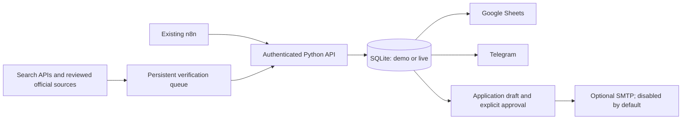

# AI Internship Discovery & Application Assistant

An evidence-first assistant for a Saudi AI student seeking summer, COOP, research, and technical internships in Jeddah, Riyadh, and Thuwal. Python handles public-source collection, SQLite tracking, Google Sheets export, Telegram notifications, and guarded email applications. Existing n8n Community Edition orchestrates the jobs; this project never replaces it.

**Current scope (0.2):** configurable broad search through the official Brave API and a credential-free Wikidata organization directory, incremental official-site/career-page collection, automatic structured internship extraction, cross-source deduplication, and the existing tracking/integration/demo workflows. KAUST, KACST and Wadi Jeddah remain priority targets, not the whole discovery database. Missing credentials, blocked sources and uncertain website ownership are reported explicitly; no seed or search snippet is presented as a verified vacancy. See [automated discovery](docs/DISCOVERY.md) for setup and coverage limits.

## Quick start

```bash
python -m venv .venv
. .venv/bin/activate
pip install -e '.[dev]'
cp .env.example .env
# Set API_TOKEN in .env; shell commands below need the same token exported.
internships demo
pytest -q
uvicorn internship_assistant.api:app --host 127.0.0.1 --port 8018 --env-file .env --no-access-log
```

Use the Docker instructions in [SETUP.md](SETUP.md) if dotenv support is unavailable. For shell startup without dotenv, export only your chosen variables explicitly; never execute an untrusted .env file as shell code.



- Summer eligibility is **Confirmed / Possible / Unknown / Ineligible** and requires explicit evidence for any non-Unknown classification. COOP is never excluded by label or relevance score.
- Every monitored listing records an official source and check time. Application instructions distinguish recruitment emails, general contacts, and manual portals.
- Notifications deduplicate unchanged listings and daily runs. Deadlines and follow-ups use Saudi dates.
- Email sending is disabled in demo and disabled by default in live mode. No workflow submits web forms or automatically sends applications.
- SQLite is the source of truth. Google Sheets mirrors dedicated tabs, including discovery candidates and company outreach methods; change statuses through the API.
- Company targets stay visible without internships. Technical departments and query locations remain uncertain until evidence supports them. Email sending stays disabled.

Read [SETUP.md](SETUP.md), [ARCHITECTURE.md](ARCHITECTURE.md), [DEVELOPMENT.md](DEVELOPMENT.md), and [CHANGELOG.md](CHANGELOG.md). API schemas are served at `/docs` on the running service. Do not expose the service publicly without TLS and access controls.
